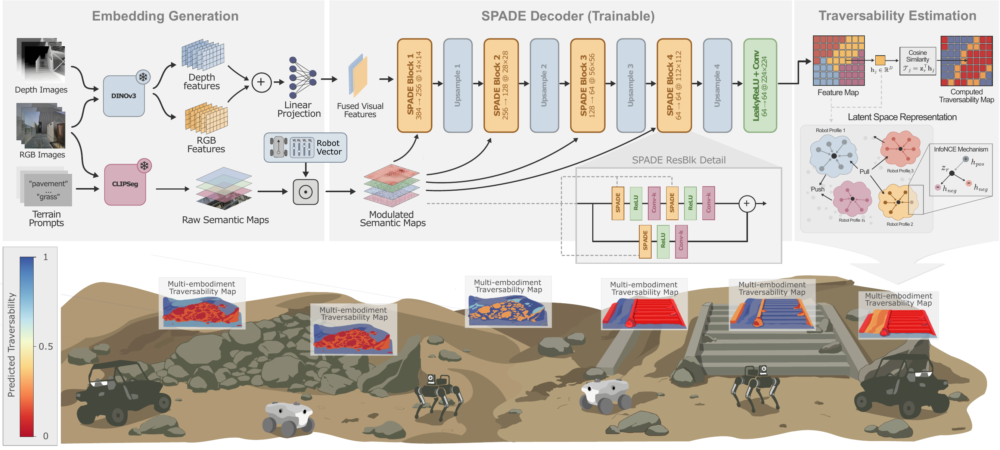
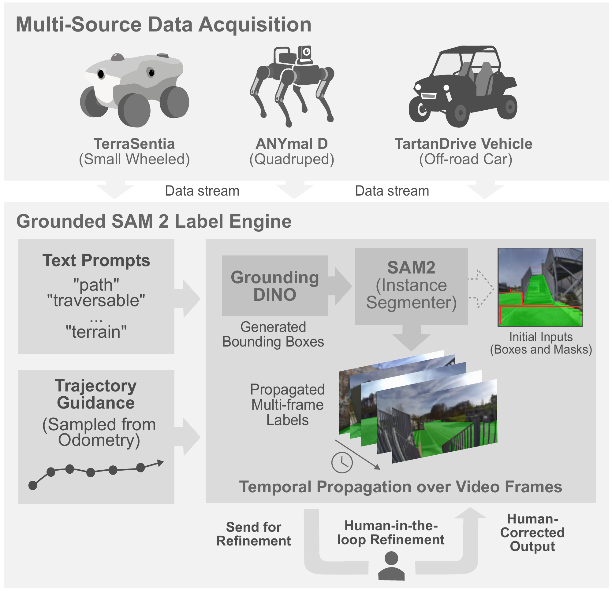
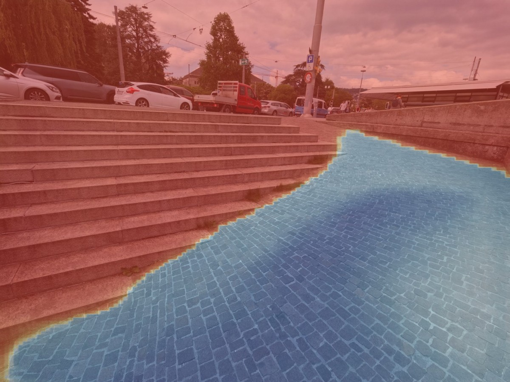
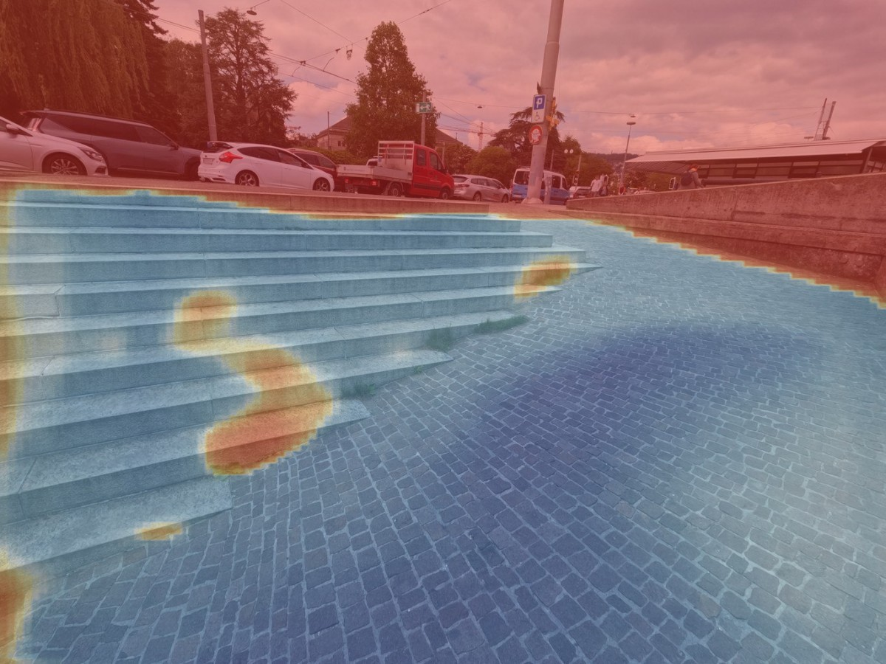

<div align="center">

# Towards Capability-Aware Traversability Navigation for Unstructured Environments

**IEEE/RSJ International Conference on Intelligent Robots and Systems (IROS) 2026**

**[Gianluca Capezzuto](https://scholar.google.com/citations?user=NFF2y9oAAAAJ&hl=en) · [Felipe Tommaselli](https://scholar.google.com/citations?user=82s0cFIAAAAJ&hl=en) · [Matheus P. Angarola](https://scholar.google.com/citations?user=V73PiAkAAAAJ&hl=en) · [Ricardo V. Godoy](https://scholar.google.com/citations?user=vVXZEB8AAAAJ&hl=en) · [Marcelo Becker](https://scholar.google.com/citations?user=c602uMcAAAAJ&hl=en)**

Mobile Robotics Group, University of São Paulo, São Carlos, SP, Brazil

<p align="center">
  <a href="https://arxiv.org/abs/2607.20679"></a>
  <a href="https://arxiv.org/pdf/2607.20679"></a>
  <a href="https://capability-aware-traversability.github.io"></a>
  <a href="https://huggingface.co/CAT-IROS-2026/cat"></a>
  <a href="LICENSE"></a>
</p>

</div>

<p align="center">
  
</p>

CAT predicts dense traversability from a single RGB-D image, conditioned on the robot that will drive over it:

🤖 **Capability-aware:** a per-robot terrain-score vector conditions the decoder, so one scene yields different maps for a wheeled robot, a quadruped, or an ATV<br>
🏷️ **Trajectory-grounded labels:** GroundingDINO + SAM 2 masks prompted by the paths robots actually drove<br>
📈 **Better path alignment:** +11.0% AUROC on executed trajectories and +15.8% AUPRC on NaviTrace over the strongest baseline<br>
⚡ **Embedded:** 4.8 Hz on a Jetson Orin Nano, deployed on Spot and TerraSentia

## 📋 Release Status

- [x] Dataset acquisition and trajectory-grounded label generation
- [x] Visual embedding extraction and capability-conditioned decoder training
- [x] Inference demo
- [x] Pretrained CAT checkpoints
- [ ] Traversability Evaluation

## ⚙️ Environment Setup

Install [uv](https://docs.astral.sh/uv/getting-started/installation/), then pick **one** extra and pass it to every `uv run`:

```bash
uv sync --locked --extra cu128   # NVIDIA GPU (CUDA 12.8)
uv sync --locked --extra cpu     # CPU only
```

## 🧱 Pretrained Backbones

CAT keeps both backbones frozen. They download on first use:

- DINOv3 ViT-B/16 (`timm`: `vit_base_patch16_dinov3.lvd1689m`)
- CLIPSeg (Hugging Face: `CIDAS/clipseg-rd64-refined`)

## 🧠 Pretrained CAT

Download the weights from [Hugging Face](https://huggingface.co/CAT-IROS-2026/cat):

```bash
uv run --locked --extra cu128 hf download CAT-IROS-2026/cat best_model.pth depth_stats.json --local-dir checkpoints/cat
```

`depth_stats.json` holds the training depth statistics. Robot scores and example RGB-D frames are in [`examples/navitrace`](examples/navitrace).

To package your own training checkpoint:

```bash
uv run --locked --extra cu128 python cat/scripts/export_checkpoint.py \
  --checkpoint /path/to/best_model.pth \
  --depth-stats /path/to/training/depth_stats.json \
  --output checkpoints/cat
```

RGB-D export requires the statistics used to extract its training embeddings. A missing cache is not evidence that a checkpoint is RGB-only.

## 📍 Minimal Usage

[`cat_demo.py`](cat_demo.py) predicts one traversability map per robot from RGB-D images. Run it on the NaviTrace examples:

```bash
uv run --locked --extra cu128 python cat_demo.py \
  --checkpoint checkpoints/cat/best_model.pth \
  --rgb examples/navitrace/*/rgb.png \
  --depth examples/navitrace/*/depth.png \
  --scores examples/navitrace/scores.yaml \
  --sensor ts
```

#### Main arguments:

- `--checkpoint`: the released or your own `best_model.pth`
- `--rgb`, `--depth`: RGB image and registered depth. Omit the depth arguments for RGB-only checkpoints
- `--scores`: [robot score YAML](data_generation/README.md#-handoff-to-cat)
- `--sensor`: depth sensor key in the checkpoint's sibling `depth_stats.json`, which supplies its clipping range and normalization
- `--robots`: robots to predict (default: all)

Results are shown in a matplotlib window (blue = high traversability, red = low).

## 📦 Data

Please refer to [data_generation/README.md](data_generation/README.md) for dataset download, label generation, and the export of `cat_data.csv`.

## 🤖 Robot Vectors

Each robot's traversability vector scores the terrain classes in `prompts` ([`cat/configs/train.yaml`](cat/configs/train.yaml)) from `0` (impassable) to `1` (fully traversable). We generated ours by querying Qwen3-VL (`qwen3-vl:8b`) once per sequence. Any capable VLM works:

1. **Describe the terrain.** Sample ~8 RGB frames uniformly from the sequence. For each frame, ask the VLM to describe every terrain class: whether it is present and what affects traversal (density, unevenness, debris, traction). Merge the answers into one summary for the sequence.
2. **Score each robot.** Give the VLM the summary and a short description of each robot's physical profile (locomotion, size, clearance, what it can and cannot climb). Ask for one score per terrain class, in the order of `prompts`, for every robot in `robots.name_map`.
3. **Save the scores** as `data_generation/dataset_processed/scores/<sequence>.yaml` ([format](data_generation/README.md#-handoff-to-cat)).

The scores are a coarse prior: training fits the recorded trajectories, so a noisy score reshapes the conditioning without overriding them. A robot without trajectories can still be trained from its vector alone.

To use the included LLM scores, select your bag during CSV export and pass `--scores_dir scores` from `data_generation/`. Each bag is matched to its score YAML in [`data_generation/scores`](data_generation/scores). See [using the bundled scores](data_generation/README.md#using-the-bundled-scores) for the command and how to assign a score to a bag without a matching file.

## 🚀 Training

Extract DINOv3 embeddings once:

```bash
uv run --locked --extra cu128 python cat/scripts/generate_embeddings.py
```

#### Main arguments:

- `--data_folder`, `--data_csv`: dataset root and CSV (default: `data_generation/dataset_processed/cat_data.csv`)
- `--save_folder`: embedding cache folder
- `--max_frames N`: use only the first N frames (smoke test)

Train the decoder:

```bash
uv run --locked --extra cu128 python -m cat.train
```

#### Main arguments:

- `data.embeddings_path`: `<save_folder>/embeddings.npy` if you changed `--save_folder`
- `training.epochs`, `training.batch_size`, `loss.temperature`
- `training.resume=/path/to/last.ckpt`: continue an epoch-boundary training checkpoint up to the total `training.epochs` limit
- `wandb.mode`: `online` (default), `offline`, or `disabled`

Runs are saved to `cat/logs/`. All settings are in [`cat/configs/train.yaml`](cat/configs/train.yaml) and accept Hydra overrides (`key=value`).

## 💡 Why CAT Works

CAT builds on two ideas.

(i) **Supervision should come from where robots actually drove.** Robot trajectories are projected into the camera and filtered for occlusion by depth. These sparse pixels prompt SAM 2 together with GroundingDINO boxes, and the masks propagate through each sequence. Frames where SAM 2 confidence or consecutive-mask IoU falls below a threshold go to a human for correction.

<p align="center">
  
</p>

(ii) **Terrain semantics are shared, but what a robot can cross is not.** CAT splits traversability into a robot-agnostic CLIPSeg terrain map and a per-robot vector scoring each terrain class, generated once per dataset and robot by a VLM. Scaling the terrain channels by that vector produces a robot-specific condition for the SPADE decoder, and each robot's traversability is the cosine similarity to its own EMA prototype.

<table>
  <tr>
    <td align="center"><br><b>Wheeled profile</b></td>
    <td align="center"><br><b>Legged profile</b></td>
  </tr>
</table>

<p align="center"><i>Same RGB-D observation, two robot profiles: the legged prediction extends across the stairs, while the wheeled prediction keeps them at low traversability (blue = high, red = low). Scene from <a href="https://leggedrobotics.github.io/navitrace_webpage/">NaviTrace</a> (<a href="https://creativecommons.org/licenses/by/4.0/">CC BY 4.0</a>), with CAT predictions overlaid.</i></p>

CAT leads all ranking metrics on the held-out trajectory split (AUROC 0.945, AUPRC 0.832) and achieves the best AUROC and AUPRC on NaviTrace. Switching from the wheeled to the legged profile raises mean traversability on legged-only paths by 14.2%, versus 2.8% on wheeled paths. In real-world trials, Spot completed 10/10 forest runs and TerraSentia avoided the staircase in 7/10 runs. All wheeled failures came from the greedy pure-pursuit planner, not perception. See the [paper](https://arxiv.org/pdf/2607.20679) for baselines, ablations, and runtime.

**Limitation:** predictions are tied to CLIPSeg and its fixed terrain prompts. Terrain without a matching prompt inherits the nearest class score, and semantic grouping errors can merge unrelated regions.

## Citation

If you find this work useful in your research, please cite:

```bibtex
@inproceedings{capezzuto2026cat,
  title         = {Towards Capability-Aware Traversability Navigation for Unstructured Environments},
  author        = {Gianluca Capezzuto and Felipe Tommaselli and Matheus P. Angarola and Ricardo V. Godoy and Marcelo Becker},
  booktitle     = {2026 IEEE/RSJ International Conference on Intelligent Robots and Systems (IROS)},
  year          = {2026},
  eprint        = {2607.20679},
  archivePrefix = {arXiv},
  primaryClass  = {cs.RO},
  url           = {https://arxiv.org/abs/2607.20679}
}
```

## Acknowledgements

We gratefully acknowledge the following open-source projects and datasets:

- [DINOv3](https://github.com/facebookresearch/dinov3), [CLIPSeg](https://github.com/timojl/clipseg), and [SPADE](https://github.com/NVlabs/SPADE)
- [WayFASTER](https://github.com/matval/wayfaster), [GrandTour](https://huggingface.co/datasets/leggedrobotics/grand_tour_dataset), and [TartanDrive 2.0](https://arxiv.org/abs/2402.01913)
- [WayFAST](https://arxiv.org/abs/2203.12071), [W-RIZZ](https://arxiv.org/abs/2406.02822), and [NaviTrace](https://leggedrobotics.github.io/navitrace_webpage/)

We thank João H. Aléssio for his assistance with robot operation and logistics during the field deployments. This work was supported by the São Paulo Research Foundation (FAPESP), Grants #2025/22381-3, #2025/20858-7, and #2025/04308-7; and by Petróleo Brasileiro S/A – Petrobras, using resources from the ANP R&D clause, in partnership with the University of São Paulo (USP) and the Fundação de Apoio à Física e à Química (FAFQ), under Cooperation Agreements #2023/00016-6 and #2023/00013-7.
